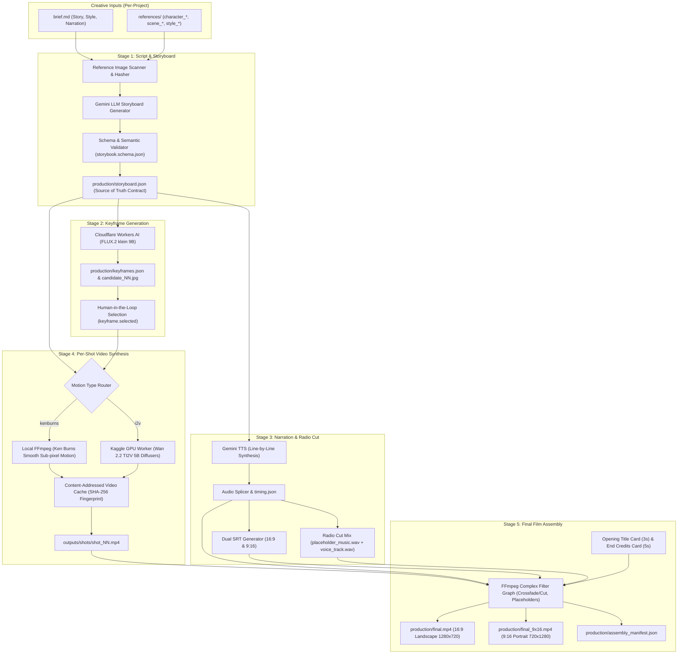

# Vid-Forge — System Architecture & Production Specification

Vid-Forge is an automated, contract-driven AI film production pipeline and CLI utility. It transforms a creative brief and optional visual reference images into a fully assembled cinematic short film delivered in both landscape (16:9, 1280×720) and vertical portrait (9:16, 720×1280) formats with synchronized narration, music, and burned-in subtitles.

---

## 1. High-Level Architecture & Core Design Principles

Vid-Forge organizes film production into independent, decoupled stages connected through strict JSON schemas, content-addressed caches, and audit logs.



### Architectural Principles

1. **Strict Contract-Driven Pipeline**: The entire workflow is governed by `schema/storybook.schema.json`. Every stage reads this contract and writes its own assets under `production/` or `outputs/`. No stage is permitted to mutate the narrative structure or timings defined in `storyboard.json`.
2. **Determinism & Content-Addressed Caching**: Model seeds, video render fingerprints, and file digests are calculated deterministically from prompt texts, model revisions, aspect ratios, and input image bytes. Rerunning a stage with identical inputs bypasses external API or GPU calls.
3. **Human-in-the-Loop Review**: Image generation produces multiple candidate keyframes per shot (`keyframe.candidates`). The generator **never auto-selects** candidate images; selection (`keyframe.selected`) is explicitly confirmed by human review.
4. **Resilient Partial Assembly**: When GPU-rendered shots are still running or missing, the final assembly engine substitutes exact-duration black placeholder intervals. This allows reviewing dialogue timing, music ducking, and subtitles without blocking on long video generation queues.
5. **Decoupled Multi-Cloud Providers**:
   - **Google Gemini**: Brief parsing, script reasoning, structured storyboard extraction, and speech synthesis (TTS).
   - **Cloudflare Workers AI**: Fast, serverless keyframe image generation (`FLUX.2 klein 9B`).
   - **Kaggle GPU Workers**: Heavy diffusion video generation (`Wan 2.2 TI2V 5B`) run as asynchronous batch jobs.
   - **Local FFmpeg**: Smooth Ken Burns pan/zoom, subtitle rendering, audio ducking, and final H.264 composition.

---

## 2. Directory Layout & Repository Structure

```text
vid-forge/
├── .env                              # Private API keys (Gemini, Cloudflare, Kaggle)
├── .env.example                      # Template for required environment variables
├── pyproject.toml                    # Package definition and CLI entry points
├── requirements.txt                  # Python dependencies
├── Makefile                          # Unified build and automation commands
├── ARCHITECTURE.md                   # System architecture and project documentation (this file)
├── DESIGN.md                         # Creative and audience design documentation
├── EXPERIMENTS.md                    # Technical benchmarks, trials, and parameters
├── FAILURES.md                       # Failure logging and post-mortem analysis
├── schema/
│   ├── README.md                     # Storyboard schema guide and semantic rules
│   └── storybook.schema.json         # JSON Schema (Draft 2020-12) for storyboard contract
├── templates/
│   └── brief.md                      # Default creative brief starter template
├── vid_forge/                        # CLI package
│   ├── __init__.py
│   ├── __main__.py                   # `python -m vid_forge` runner
│   └── cli.py                        # Unified command dispatcher and argument parser
├── pipeline/                         # Modular pipeline stages
│   ├── smoke-tests/
│   │   ├── smoke_test.py             # Latency & API connectivity health check
│   │   └── kaggle_gpu_smoke_test.py  # Kaggle notebook CUDA validation snippet
│   ├── script/
│   │   ├── reference_images.py       # Reference image scanner, validator, and hasher
│   │   ├── storyboard.py             # Gemini brief-to-storyboard generator
│   │   └── validate_storyboard.py    # Schema and semantic validator
│   ├── keyframes/
│   │   └── keyframes.py              # Cloudflare Workers AI batch keyframe generator
│   ├── narration/
│   │   ├── narration.py              # Gemini TTS voice generation and SRT builder
│   │   ├── radio_cut.py              # Placeholder audio bed & radio cut preview
│   │   └── stage_io.py               # Shared file IO helpers for audio pipeline
│   ├── video-assemble/
│   │   ├── video_assemble.py         # Shot clip coordinator (local & Kaggle jobs)
│   │   ├── video_worker.py           # Kaggle remote execution bundle for Wan 2.2
│   │   ├── video_cache.py            # Immutable content-addressed video cache
│   │   └── providers.py              # Provider interfaces (Wan 2.2, Ken Burns, Hunyuan)
│   └── assembly/
│       └── assemble.py               # FFmpeg multi-stream film compositor
└── projects/                         # Isolated production workspaces
    ├── theLastSeed/                  # Primary production short film
    └── initiation/                   # Pilot benchmark project
```

---

## 3. Pipeline Stages Detailed Specification

### Stage 1: Script & Storyboard (`pipeline/script/`)

- **Inputs**: `projects/<project>/input/brief.md` and `projects/<project>/input/references/`.
- **Output**: `projects/<project>/production/storyboard.json`.
- **Reference Scanner (`reference_images.py`)**:
  - Scans `input/references/` for files named `character_<name>.png`, `scene_<name>.jpg`, or `style_<name>.webp`.
  - Validates image magic bytes, enforces a 4 MB individual / 12 MB aggregate limit, and computes SHA-256 digests.
- **Generation Engine (`storyboard.py`)**:
  - Computes a SHA-256 digest of `brief.md`. If `storyboard.json` exists with a matching digest, generation is skipped to avoid wasting API quota (override with `--force`).
  - Calls Gemini (`gemini-3.5-flash-lite` or `GEMINI_MODEL`) with the brief text and inline reference image bytes.
  - Implements a self-repair feedback loop (up to 3 attempts), feeding semantic validation errors back to the model if constraints are violated.
  - Raw attempts are captured in `outputs/storyboard/attempt_N.json`.
- **Validation Engine (`validate_storyboard.py`)**:
  - Evaluates against `schema/storybook.schema.json`.
  - Enforces semantic rules: unique IDs, valid narration references, character presence in `style.characters`, total duration within 60–90 seconds, valid music cue bounds, and max words per second.

### Stage 2: Keyframe Candidate Generation (`pipeline/keyframes/`)

- **Inputs**: `production/storyboard.json` and project reference images.
- **Outputs**:
  - Image files: `production/keyframes/<shot_id>/candidate_NN.jpg` (1024×576, 16:9).
  - Manifest: `production/keyframes.json`.
- **Cloudflare Workers AI Engine**:
  - Uses model `@cf/black-forest-labs/flux-2-klein-9b`.
  - Builds prompt: `style.prefix` + character visual descriptions + `shot.keyframe.prompt`.
  - Resolves up to 4 reference images (`shot.characters` and `shot.references`), downscaled to $\le 500\text{ px}$ side length to satisfy model limits.
  - Generates $N$ candidates (`keyframe.candidates`, default 2–4) with deterministic seeds ($S, S+1, \dots$).
  - Appends performance metrics and latency to `runs.jsonl`.
  - Never overwrites `keyframe.selected` in `storyboard.json` automatically.

### Stage 3: Voice, Narration, & Radio Cut (`pipeline/narration/`)

- **Inputs**: `production/storyboard.json` (`narration` block) and `meta.voice_style`.
- **Outputs**:
  - Line audio: `outputs/narration/line_NN.wav` (with `.meta.json` cache).
  - Timing manifest: `outputs/narration/timing.json`.
  - Stitched voice track: `outputs/narration/voice_track.wav`.
  - Subtitles: `outputs/narration/narration_16x9.srt` and `narration_9x16.srt`.
  - Radio Cut: `outputs/radio_cut/placeholder_music.wav`, `radio_cut.mp4`.
- **Synthesis & Timing**:
  - Generates speech line-by-line using Gemini TTS in the authored language (`am` for Amharic).
  - Probes exact wave durations, computes cumulative offsets, and calculates shot-aligned timing.
  - Generates dual SRT subtitle tracks with font size and wrap parameters customized for 16:9 landscape vs. 9:16 vertical frames.
  - `radio_cut.py` mixes narration over an acoustic ducked placeholder music bed and outputs an interim diagnostic video on a black screen.

### Stage 4: Per-Shot Video Synthesis (`pipeline/video-assemble/`)

- **Inputs**: Selected keyframes from `production/keyframes/` and motion configurations from `storyboard.json`.
- **Output**: Individual normalized video clips `outputs/shots/<shot_id>.mp4` (1280×720, 24 FPS, H.264, silent).
- **Local Motion Engine (`Ken Burns`)**:
  - Applied when `shot.motion.type == "kenburns"`.
  - Uses a local FFmpeg `perspective` filter graph (sub-pixel, bicubic) executing a slow 12% eased camera move (zoom-in, zoom-out, pan-left, pan-right).
  - Instant, zero GPU quota cost.
- **Remote Diffusion Engine (`Kaggle Wan 2.2 TI2V`)**:
  - Applied when `shot.motion.type == "i2v"`.
  - Packages selected keyframe images and prompts into a private Kaggle Dataset.
  - Dispatches an asynchronous GPU Kernel (`video_worker.py`) using `Wan-AI/Wan2.2-TI2V-5B-Diffusers`.
  - Utilizes sequential CPU offloading and VAE tiling to execute on a single 16 GB GPU (Nvidia Tesla T4) or A100.
  - Normalizes generated frames (1280×704 native) to standard 1280×720 at storyboard FPS.
- **Content-Addressed Video Cache (`video_cache.py`)**:
  - Cache key is a SHA-256 fingerprint of: input image bytes, prompt, negative prompt, model ID, seed, FPS, steps, and crop dimensions.
  - Cached under `cache/videos/<prefix>/<fingerprint>/default/video.mp4`.
  - Atomic publication to `outputs/shots/<shot_id>.mp4`.

### Stage 5: Final Film Assembly (`pipeline/assembly/`)

- **Inputs**: Shot clips, `timing.json`, `voice_track.wav`, `placeholder_music.wav`, and SRT subtitles.
- **Outputs**:
  - `production/final.mp4` (1280×720 Landscape, 16:9).
  - `production/final_9x16.mp4` (720×1280 Portrait, 9:16).
  - `production/assembly_manifest.json`.
- **Composition & Audio Mixing**:
  - Places a 3-second opening title card with `meta.title`.
  - Concatenates shot clips in strict storyboard order using hard cuts or `xfade` crossfades (default 0.5s).
  - If clips are missing, renders exact-duration black placeholder frames.
  - Places a 5-second closing card with `end_card.text` and `end_card.credits`.
  - Aligns narration audio shifted by the 3-second opening card offset.
  - Mixes background music ducked by $-12\text{ dB}$ during narration segments.
  - Burns in aspect-ratio-specific subtitles: centered bottom for 16:9, elevated above UI safe-zones for 9:16.
  - Performs full post-render decode validation before updating final files.

---

## 4. Project Isolation & Data Architecture

Projects are isolated under `projects/<project_name>/`. Every project maintains its own inputs, outputs, cache, and audit trails:

```text
projects/<project_name>/
├── input/
│   ├── brief.md                          # Creative direction, audience, story arc, narration
│   └── references/                       # Character, scene, and style reference images
├── production/
│   ├── storyboard.json                   # Master production contract
│   ├── keyframes.json                    # Candidate keyframes index
│   ├── video_manifest.json               # Status of shot clip generation
│   ├── assembly_manifest.json            # Final assembly checksums and media metadata
│   ├── final.mp4                         # 16:9 landscape render
│   ├── final_9x16.mp4                    # 9:16 portrait render
│   └── keyframes/
│       └── <shot_id>/
│           ├── candidate_01.jpg
│           └── candidate_02.jpg
├── outputs/
│   ├── storyboard/                       # Raw model attempts during storyboard generation
│   ├── narration/                        # Per-line WAV audio files, timing.json, voice_track.wav, SRT files
│   ├── radio_cut/                        # Placeholder music bed and assembled radio cut MP4
│   ├── shots/                            # Active per-shot clips (shot_01.mp4 ... shot_NN.mp4)
│   └── smoke/                            # Smoke test output captures
├── cache/
│   ├── video-jobs/                       # Local staging for Kaggle datasets and kernel bundles
│   └── videos/                           # Content-addressed immutable cache of generated video clips
└── runs.jsonl                            # Append-only JSONL log of every API call and run latency
```

### The `runs.jsonl` Audit Specification

Every call to an external provider (Gemini, Cloudflare, Kaggle) appends a record:
```json
{
  "ts": "2026-11-26T10:15:30Z",
  "stage": "keyframes",
  "provider": "cloudflare",
  "operation": "image_generation",
  "model": "@cf/black-forest-labs/flux-2-klein-9b",
  "shot_id": "shot_01",
  "candidate": 1,
  "seed": 482910,
  "latency_ms": 7820,
  "success": true,
  "output": "production/keyframes/shot_01/candidate_01.jpg"
}
```

---

## 5. Details of Projects in the Repository

Vid-Forge currently hosts two active projects under `projects/`:

### 1. `theLastSeed` (Primary Production Film)

- **Concept**: An Ethiopian highland folktale exploring faith, generational patience, and environmental hope.
- **Narrative Arc**:
  - **Drought & Despair**: Severe drought parches a rural highland village; the soil is cracked and dusty.
  - **The Dilemma**: Alemu, an elderly farmer, holds the community's last remaining seed grain. Villagers urge him to eat it to survive.
  - **The Act of Faith**: Alemu refuses to consume the future. He digs into the dry earth and plants the seed.
  - **The Transformation**: Rain returns; years pass; the seed grows into an expansive, fruit-bearing shade tree where the next generation gathers.
- **Technical Profile**:
  - **Timeline**: 11 shots, 84.92 seconds total runtime.
  - **Narration**: Amharic (`am`), reflective and warm vocal style; 11 corresponding lines in `outputs/narration/`.
  - **Subtitles**: English (`en`) burned-in.
  - **Musical Direction**: Traditional Ethiopian acoustic instrumentation (washint, krar, masinko, kebero).
  - **Visual Strategy**:
    - Character consistency anchored on reference images: `character_alemu.png`, `character_girl.png`, `character_villagers.png`.
    - Scene references: `scene_drought_village.jpg`, `scene_grown_tree.jpg`.
    - Motion distribution: 2 Ken Burns still-motion shots (`shot_02`, `shot_06`) and 9 diffusion video shots (`Wan 2.2 TI2V`).
- **Production Status**:
  - Storyboard validated and locked (`storyboard.json`).
  - Keyframes: 2 candidates generated for all 11 shots (`candidate_01.jpg`, `candidate_02.jpg`) with selections marked.
  - Narration & Subtitles: All 11 Amharic voice clips synthesized and aligned; `narration_16x9.srt` and `narration_9x16.srt` generated.
  - Video Generation: `shot_02` and `shot_06` generated locally via Ken Burns. The 9 Wan shots are pending remote GPU execution.
  - Preview Assembly: Assembly completed with black placeholders for unrendered shots, verifying end-to-end audio, timing, and subtitle layout.

---

## 6. CLI Command Reference & Workflows

Vid-Forge provides a unified CLI dispatched through `vid_forge/cli.py` or `python -m vid_forge.cli`:

| Command | Syntax | Description |
|---|---|---|
| `init` | `vid-forge init name=<project>` | Creates `projects/<project>/` structure and initializes `input/brief.md`. |
| `storyboard` | `vid-forge storyboard project=<project> [--force]` | Generates and validates `storyboard.json` from `brief.md`. |
| `validate` | `vid-forge validate project=<project>` | Validates `storyboard.json` against schema and semantic rules. |
| `keyframes` | `vid-forge keyframes project=<project> [--shot <id>] [--candidate-count <n>] [--force]` | Generates candidate keyframes via Cloudflare Workers AI. |
| `narration` | `vid-forge narration project=<project> [line=<id>] [--force] [--no-assemble]` | Generates Gemini TTS voice lines, timing map, subtitles, and radio cut. |
| `radio_cut` | `vid-forge radio_cut project=<project>` | Re-mixes the diagnostic radio cut from existing audio files. |
| `video` | `vid-forge video project=<project> [--shot <id>] [--provider wan22] [--accelerator <name>] [--force] [--dry-run]` | Generates per-shot MP4 videos locally (Ken Burns) or on Kaggle (Wan 2.2). |
| `assemble` | `vid-forge assemble project=<project> [--transition cut\|crossfade] [--output <file>] [--force] [--dry-run]` | Composites final 16:9 and 9:16 films with audio, subtitles, and cards. |
| `film` | `vid-forge film project=<project> [options...]` | Executes the complete end-to-end pipeline in order, stopping on any error. |
| `smoke_test` | `vid-forge smoke_test [project=<project>]` | Tests API connectivity and response latency for all configured services. |

### End-to-End Autonomous Pipeline (`vid-forge film`)

The `film` command automates the entire production flow:
```powershell
vid-forge film project=theLastSeed --candidate-count 2 --steps 20 --accelerator NvidiaTeslaT4 --transition crossfade
```
1. Checks for `production/storyboard.json`; generates from `input/brief.md` if missing.
2. Runs schema and semantic validation.
3. Generates missing keyframe candidates.
4. Generates missing narration lines, timing, and subtitles.
5. Renders all un-cached video shots (Ken Burns locally, Wan 2.2 via Kaggle).
6. Assembles `final.mp4` and `final_9x16.mp4`.

---

## 7. Operational Troubleshooting & Known Constraints

- **Cloudflare Reference Image Size**: FLUX.2 klein requires reference images to be strictly $< 512\times 512\text{ px}$. `keyframes.py` automatically resizes images to $\le 500\text{ px}$ before uploading.
- **Kaggle GPU VRAM Constraints**: Wan 2.2 TI2V (5B) requires $\ge 24\text{ GB}$ VRAM for native inference. To fit within Kaggle's free Nvidia Tesla T4 (16 GB), `video_worker.py` enables Diffusers sequential CPU offload and VAE tiling. This trades inference speed for memory headroom.
- **FFmpeg Dependencies**: Both `ffmpeg` and `ffprobe` must be installed with `libx264` enabled on system `PATH`.
- **Environment Variables**: Sensitive keys (`GEMINI_API_KEY`, `CLOUDFLARE_WORKERS_AI_API_KEY`, `KAGGLE_API_TOKEN`) must reside exclusively in `.env` and must never be committed to source control.
