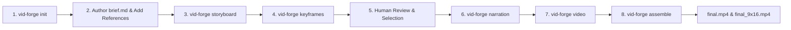

# Vid-Forge

Vid-Forge is an automated, contract-driven AI film production toolchain and CLI. It transforms a creative brief and optional character/scene reference images into fully realized, broadcast-ready short films delivered in both **16:9 landscape (1280×720)** and **9:16 vertical portrait (720×1280)** with synchronized speech, music, and burned-in subtitles.

Vid-Forge orchestrates multimodal cloud and local providers:
- **Google Gemini**: Script reasoning, structured storyboard extraction, and speech synthesis (TTS).
- **Cloudflare Workers AI**: Fast, serverless keyframe candidate generation (`FLUX.2 klein 9B`).
- **Kaggle GPU Workers**: Diffusion video generation (`Wan 2.2 TI2V 5B`) running on remote GPU hardware.
- **Local FFmpeg**: Subtle Ken Burns pan/zoom camera motion, aspect ratio normalization, subtitle compositing, and final audio/video mixing.

---

## 1. Quickstart

### Prerequisites & Requirements

1. **Python 3.11+** installed.
2. **FFmpeg & FFprobe** with `libx264` support installed and accessible on your system `PATH`.
   - *Windows (winget):* `winget install Gyan.FFmpeg`
   - *macOS (Homebrew):* `brew install ffmpeg`
   - *Linux (Ubuntu/Debian):* `sudo apt update && sudo apt install ffmpeg`
3. **API Keys & Accounts**:
   - **Gemini API Key**: From [Google AI Studio](https://aistudio.google.com/).
   - **Cloudflare Workers AI**: Account ID and API Token with Workers AI read/write permissions.
   - **Kaggle API Credentials**: Kaggle username and API token from your Kaggle Account settings (`kaggle.json`).

### Setup Process

Clone the repository and install the package:

```bash
git clone https://github.com/dagim-mante/Vid-Forge.git
cd Vid-Forge
```

Create a virtual environment and install dependencies in editable mode:

```bash
# On Linux / macOS:
python3 -m venv .venv
source .venv/bin/activate
pip install -e .

# On Windows (PowerShell):
python -m venv .venv
.venv\Scripts\Activate.ps1
pip install -e .
```

Configure your environment variables by copying `.env.example`:

```bash
# On Linux / macOS:
cp .env.example .env

# On Windows (PowerShell):
Copy-Item .env.example .env
```

Open `.env` and fill in your credentials:

```dotenv
# Google Gemini
GEMINI_API_KEY=your_gemini_api_key
GEMINI_MODEL=gemini-3.5-flash-lite
NARRATION_MODEL=gemini-3.8-flash-lite-tts

# Cloudflare Workers AI
CLOUDFLARE_WORKERS_AI_ACCOUNT_ID=your_account_id
CLOUDFLARE_WORKERS_AI_API_KEY=your_api_token
CLOUDFLARE_IMAGE_MODEL=@cf/black-forest-labs/flux-2-klein-9b

# Kaggle API
KAGGLE_USERNAME=your_kaggle_username
KAGGLE_API_TOKEN=your_kaggle_api_token
KAGGLE_ACCELERATOR=NvidiaTeslaT4
```

Verify your setup and API connectivity by running the smoke test:

```bash
vid-forge smoke_test
```

---

## 2. Automating an Existing Film (`theLastSeed`)

The repository includes a complete production project under `projects/theLastSeed/` — an 11-shot Ethiopian highland folktale film about patience, environmental renewal, and faith in the future.

### Running a Dry Run

Before consuming API or GPU credits, inspect the planned stages, shot durations, cache hits, and target outputs:

```bash
vid-forge film project=theLastSeed --dry-run
```

### Running the End-to-End Autonomous Pipeline

The `film` command automates all production stages sequentially:

```bash
vid-forge film project=theLastSeed --candidate-count 2 --steps 20 --accelerator NvidiaTeslaT4
```

What the `film` command executes:
1. **[1/6] Reusing Storyboard**: Reuses the validated, locked storyboard contract at `projects/theLastSeed/production/storyboard.json`.
2. **[2/6] Validating Storyboard**: Verifies timeline boundaries, shot durations, character references, and subtitle bounds.
3. **[3/6] Generating Keyframes**: Generates candidate images via Cloudflare Workers AI for any shots missing candidates.
4. **[4/6] Generating Narration & Subtitles**: Synthesizes 11 Amharic voice lines via Gemini TTS, builds `timing.json`, creates `narration_16x9.srt` and `narration_9x16.srt`, and renders a preview radio cut.
5. **[5/6] Generating Shot Videos**:
   - `shot_02` & `shot_06` (Ken Burns): Generates subtle 4% eased camera pan/zoom locally with zero GPU cost.
   - Remaining shots (Wan 2.2): Packages jobs and submits them to the Kaggle GPU worker with sequential CPU offload.
6. **[6/6] Assembling Final Films**: Blends all clips, applies opening title (3s) and end credits (5s), burns in subtitles, mixes ducked audio, and outputs the final media.

### Choosing Transitions

Customize transitions between shots with hard cuts (default) or smooth crossfades:

```bash
# Smooth 0.5s crossfade between adjacent shots:
vid-forge film project=theLastSeed --transition crossfade --transition-duration 0.5
```

### Production Outputs

When assembly finishes, your completed films and metadata are ready:
- **16:9 Landscape Video**: `projects/theLastSeed/production/final.mp4` (1280×720, 24 FPS)
- **9:16 Vertical Video**: `projects/theLastSeed/production/final_9x16.mp4` (720×1280, 24 FPS)
- **Assembly Manifest**: `projects/theLastSeed/production/assembly_manifest.json`
- **Execution Audit**: `projects/theLastSeed/runs.jsonl`

> **Note on Partial Renders**: If video generation for some Wan diffusion shots is pending or cancelled, Vid-Forge substitutes black placeholder clips of the exact planned duration. This lets you review the assembled cut, narration sync, audio ducking, and subtitle styling immediately without waiting for full GPU runs.

---

## 3. Guide: Creating and Running a New Project

Vid-Forge supports creating custom films from scratch with your own narrative, characters, and style.



### Step 1: Initialize the Project Workspace

Run `init` with your project name (letters, numbers, underscores only):

```bash
vid-forge init name=my_film
```

This creates the isolated workspace structure:
```text
projects/my_film/
├── input/
│   ├── brief.md              # Creative brief template
│   └── references/           # Drop reference images here
└── production/               # Production manifests and final videos
```

### Step 2: Author the Creative Brief

Edit `projects/my_film/input/brief.md` to define:
- **Film Overview**: Title, target duration (60–90 seconds), genre, tone, visual style.
- **Languages**: Narration language code (e.g. `en` for English, `am` for Amharic) and voice style.
- **Characters**: Recurring character identities and visual traits.
- **Narrative Arc**: Scene breakdown with narration lines, camera directions, and music mood.

### Step 3: Add Visual Reference Images (Optional)

Drop visual anchors into `projects/my_film/input/references/`. Filenames define their role:
- `character_<name>.png` (e.g. `character_elena.png`): Character identity anchor.
- `scene_<name>.jpg` (e.g. `scene_observatory.jpg`): Specific location anchor.
- `style_<name>.webp` (e.g. `style_scifi_noir.webp`): Global artistic and lighting palette.

### Step 4: Generate & Validate the Storyboard

Generate the structured production contract:

```bash
vid-forge storyboard project=my_film
```

Gemini reads your brief and reference images, extracts the shot timeline, applies consistent seeds, and verifies the schema. If you manually tweak `projects/my_film/production/storyboard.json`, re-validate:

```bash
vid-forge validate project=my_film
```

### Step 5: Generate Keyframes & Select Candidates

Generate visual candidate images for each shot:

```bash
# Generate 2 candidates per shot:
vid-forge keyframes project=my_film --candidate-count 2

# Or generate for a specific shot:
vid-forge keyframes project=my_film --shot shot_01
```

Candidates are saved to `projects/my_film/production/keyframes/<shot_id>/candidate_NN.jpg`.

**Human Review**: Open the images, select your preferred candidate for each shot, and update `keyframe.selected` (1-based index) in `projects/my_film/production/storyboard.json`.

### Step 6: Generate Narration, Timing & Subtitles

Synthesize voice audio and generate the timing plan:

```bash
vid-forge narration project=my_film
```

This produces:
- Per-line speech audio: `projects/my_film/outputs/narration/line_NN.wav`
- Stitched master voice track: `projects/my_film/outputs/narration/voice_track.wav`
- Shot timing map: `projects/my_film/outputs/narration/timing.json`
- Dual subtitles: `narration_16x9.srt` and `narration_9x16.srt`
- Preview radio cut: `projects/my_film/outputs/radio_cut/radio_cut.mp4`

### Step 7: Generate Per-Shot Video Clips

Render the selected keyframes into video clips:

```bash
# Test the render plan locally:
vid-forge video project=my_film --dry-run

# Run per-shot video generation:
vid-forge video project=my_film --provider wan22 --steps 20 --accelerator NvidiaTeslaT4
```

- Shots with `motion.type == "kenburns"` render locally via FFmpeg.
- Shots with `motion.type == "i2v"` are submitted as a Kaggle GPU worker batch.

### Step 8: Assemble the Final Film

Combine all clips, audio, music bed, and subtitles into the finished films:

```bash
vid-forge assemble project=my_film --transition crossfade --transition-duration 0.5
```

Outputs are saved to `projects/my_film/production/final.mp4` and `final_9x16.mp4`.

*(Tip: Once your brief and selections are set, you can run all steps automatically with `vid-forge film project=my_film`!)*

---

## 4. CLI Command Reference

All operations can be invoked using `vid-forge <command>` or `python -m vid_forge.cli <command>`:

| Command | Syntax | Description |
|---|---|---|
| `init` | `vid-forge init name=<name>` | Initializes a new project directory with brief template and folders. |
| `storyboard` | `vid-forge storyboard project=<name> [--force]` | Generates `production/storyboard.json` from `input/brief.md`. |
| `validate` | `vid-forge validate project=<name>` | Validates `storyboard.json` against schema and semantic rules. |
| `keyframes` | `vid-forge keyframes project=<name> [--shot <id>] [--candidate-count <n>] [--force]` | Generates candidate keyframe images via Cloudflare Workers AI. |
| `narration` | `vid-forge narration project=<name> [line=<id>] [--force] [--no-assemble]` | Generates Gemini TTS voice lines, timing map, subtitles, and radio cut. |
| `radio_cut` | `vid-forge radio_cut project=<name>` | Re-mixes the diagnostic radio cut from existing audio files. |
| `video` | `vid-forge video project=<name> [--shot <id>] [--provider wan22] [--steps <n>] [--dry-run]` | Generates per-shot video clips (Ken Burns locally, Wan 2.2 via Kaggle). |
| `assemble` | `vid-forge assemble project=<name> [--transition cut\|crossfade] [--output <file>] [--force]` | Composites final 16:9 and 9:16 MP4s with audio, subtitles, and title/end cards. |
| `film` | `vid-forge film project=<name> [options...]` | Executes the complete production pipeline end-to-end. |
| `smoke_test` | `vid-forge smoke_test [project=<name>]` | Tests API connectivity and response latency for all configured services. |

---

## 5. Architecture & Documentation Links

For deep architectural details, design philosophy, and troubleshooting, see:
- [ARCHITECTURE.md](file:///c:/Users/dagim/Documents/dev/Python/vid-forge/ARCHITECTURE.md): System architecture, stage interactions, caching algorithms, and project profiles.
- [DESIGN.md](file:///c:/Users/dagim/Documents/dev/Python/vid-forge/DESIGN.md): Story structure, audience feedback plan, and aesthetic guidelines.
- [FAILURES.md](file:///c:/Users/dagim/Documents/dev/Python/vid-forge/FAILURES.md): Known issues, GPU limits, and recovery playbooks.
- [schema/README.md](file:///c:/Users/dagim/Documents/dev/Python/vid-forge/schema/README.md): JSON schema reference and semantic validation rules for `storyboard.json`.
